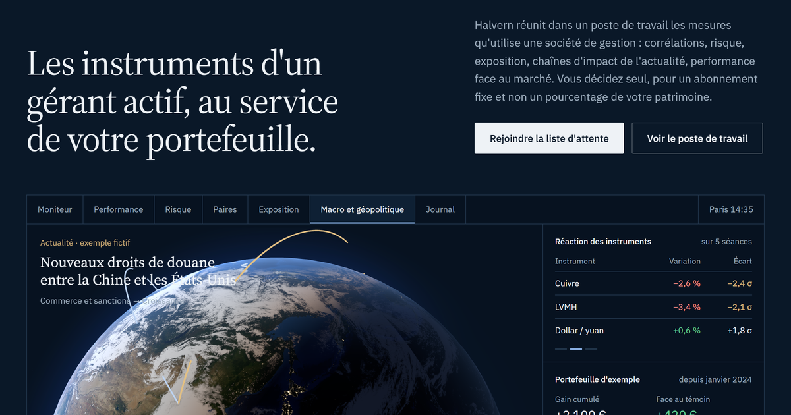

# Halvern

Site de présentation de **Halvern**, un poste de travail de gestion de portefeuille pour investisseurs particuliers :
corrélations et décorrélation, risque (VaR, contributions, stress tests), exposition réelle, chaînes d'impact de
l'actualité, mesure de chaque décision face au MSCI World.

**Site en ligne : https://rlekmine-oa.github.io/halvern/**

## Contenu

- Six pages statiques (HTML, CSS, JavaScript sans dépendance de compilation), hébergées sur GitHub Pages.
- Globe 3D en ouverture ([globe.gl](https://github.com/vasturiano/globe.gl), three.js) : imagerie NASA en 8192 px
  (Blue Marble, Black Marble, mosaïque VIIRS, bathymétrie GEBCO), jour et nuit calculés à l'heure réelle par la carte
  graphique, nuages et leur ombre, reflet du soleil sur l'eau, chaînes d'impact fictives entre actualités et marchés.
- Simulateur de frais (gestion déléguée face à un abonnement fixe), récits animés de la méthode (corrélations,
  performance, risque), comparatif et tarifs.
- Chiffres sourcés (AMF, S&P Dow Jones Indices SPIVA) ; toutes les données de portefeuille affichées sont fictives.

Le site présente une application de bureau développée par ailleurs (Python, React) ; ce dépôt ne contient que le site.

## Avertissement

Halvern est un projet en préparation : aucun service n'est vendu à ce jour. Le site ne fournit ni conseil en
investissement ni recommandation sur un instrument financier.

## Crédits

Imagerie de la Terre : NASA Earth Observatory et NASA GIBS (domaine public) ; bathymétrie GEBCO. Globe : globe.gl
(licence MIT). Polices : IBM Plex Sans et Source Serif 4 (SIL Open Font License).

© 2026 LEKMINE Rayan. Tous droits réservés.
